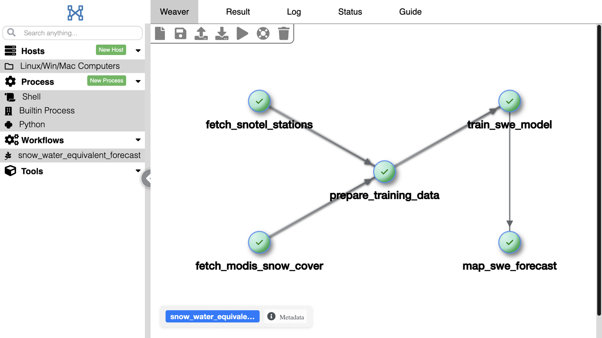

[](https://github.com/ESIPFed/Geoweaver/actions)
[](https://github.com/ESIPFed/Geoweaver/blob/main/LICENSE)
[](https://pypi.org/project/pygeoweaver/)
[](https://hub.docker.com/r/geoweaver/geoweaver)
[](docs/java17-migration.md)
[](https://github.com/ESIPFed/Geoweaver/stargazers)


**Geoweaver turns the scripts behind your research into workflows you can run, rerun and share, on your laptop, on SSH servers and on HPC clusters.**

Write each step in Python, shell or a Jupyter notebook, connect the steps in the browser, and run the whole chain on the machines that hold your data. Geoweaver keeps every version of the code, every log and every result, so you can see what ran, where, and with which code, months later. It is one Java program with a built-in database: nothing else to install, and your code and data stay on your own machines.

AI coding agents (Claude Code, Codex, Cursor) can build and run the same workflows through a [command line](#command-line) and a secure [Agent API](#for-ai-coding-agents), while you watch the result in the browser.



[Install](#install) · [Documentation](docs/index.md) · [Website](https://geoweaver.dev) · [Python package](https://github.com/ESIPFed/pygeoweaver) · [What's new](#whats-new-in-3x) · [Issues](https://github.com/ESIPFed/Geoweaver/issues)

## Why Geoweaver

Research code tends to grow into a folder of scripts, notebooks and cron jobs spread over several servers, and the knowledge of how to run it lives in one person's head. Geoweaver keeps it in one place:

- **Your scripts, unchanged.** A step is a Python or shell script, a Jupyter notebook, or a built-in task. Nothing to rewrite, no workflow language to learn.
- **Run where the data is.** Each step runs on any host you register: this computer, an SSH server, an HPC login node, Jupyter servers or Google Earth Engine. Choose the host and Python environment per run.
- **Nothing is lost.** Every run records the code that ran, its full log, timing and status. Compare versions, restore a workflow to an earlier checkpoint, and browse the result files.
- **Share it whole.** Export a workflow with its code and history as one zip; a colleague imports it and runs it.
- **Private by default.** Geoweaver runs on your machine or your server. Code, data and passwords never go to a third-party service.

Geoweaver grew out of geoscience and Earth observation AI workflows (snow, wildfire, crop and climate models), and it works for any multi-step data pipeline.

## Install

Geoweaver needs **Java 17** (17.0.21 or newer). Pick one way:

**Python** (recommended; installs Java for you if needed)

```bash
pip install pygeoweaver
gw start
```

**Jar**

```bash
curl -LO https://github.com/ESIPFed/Geoweaver/releases/download/latest/geoweaver.jar
java -jar geoweaver.jar
```

**Docker**

```bash
docker run -d -p 127.0.0.1:8070:8070 -e GEOWEAVER_PASSWORD='choose-a-password' \
  -v geoweaver-home:/home/marsvegan --name geoweaver geoweaver/geoweaver
```

Then open **http://localhost:8070/Geoweaver**. The first start prints a password for this computer in its log; change it any time with `java -jar geoweaver.jar resetpassword` (or `gw reset_password`). More options, including Windows and macOS installers and HPC clusters without root: [installation guide](docs/install.md).

Upgrading from an earlier version? Read [upgrading](docs/upgrade.md) first. **3.3.2 is a security release: please upgrade every Geoweaver 3.3.1 and older,** especially servers other computers can reach.

## Your first workflow

1. **Hosts:** this computer is ready to use. Add an SSH server or cluster login node with **New Host** ([hosts](docs/host.md)).
2. **Processes:** click **New Process**, choose Python, Shell or Notebook, and paste your code. Press **Run** to try it on any host ([processes](docs/process.md)).
3. **Workflows:** drag processes onto the canvas and connect them in the order they must run. Press **Run** and watch each step turn green, or red with its log one click away ([workflows](docs/workflow.md)).
4. **History:** every run of every step is kept. Open an old run to see its code and log, or restore the workflow to that point.

## Features

| | |
| --- | --- |
| **Visual workflows** | Build workflows on a canvas, run them on one host or spread steps over several, skip steps, stop runs, and see live status and logs. |
| **Hosts** | This computer, SSH servers and HPC login nodes, Jupyter / JupyterHub / JupyterLab servers, Google Earth Engine. Pick a Python environment per run ([environments](docs/environment-selection.md)). |
| **History and checkpoints** | Each run keeps the exact code, log, status and timing. Restore a workflow checkpoint to rerun past work. |
| **Results** | Browse, preview and download the files your workflow produced. |
| **Command line** | Everything the browser does: create, run, follow and stop processes and workflows from scripts, cron or SSH ([commands](docs/shared-database.md#through-commands)). |
| **Agent API** | A JSON HTTP API for AI coding agents, answering only this computer by default ([Agent API](docs/agent-api.md)). |
| **Live collaboration** | Several browsers, commands and agents can work on one workspace. Open pages update within a second when someone else changes or runs something. |
| **Clusters and Open OnDemand** | Several Geoweaver instances (an SSH login node and an Open OnDemand session, for example) share one database in your home folder ([shared database](docs/shared-database.md)). |
| **Built to last** | Built-in H2 database, or MySQL / PostgreSQL ([database](docs/database-configuration.md)). Long logs go to compressed files, and disk use stays bounded, which suits home folders with quotas. |
| **Share and reuse** | Export and import workflows as zip files, together with their code and history. |

## Command line

The Geoweaver jar does everything the browser does from a terminal, with or without a running server. `--json` prints one JSON document, which makes it easy to script.

```bash
alias gwcli='java -jar ~/geoweaver.jar'   # wherever you saved the jar

gwcli process create --name clean_data --lang python --code-file clean.py --json
gwcli workflow create --name daily --steps <process-id-1>,<process-id-2> --json
gwcli run workflow <workflow-id> --detach --json     # returns {"runId": ...} and keeps running
gwcli run status <run-id> --wait 600                 # wait until it ends
gwcli run log <run-id> -f                            # follow the log
```

Runs started from the command line show up live in any open browser page, and **Stop** in the browser stops them. See [commands](docs/shared-database.md#through-commands) for the full list.

## For AI coding agents

Geoweaver gives an AI coding agent (Claude Code, Codex, Cursor) a safe, reproducible place to run science code: the agent writes the steps and runs the workflow, and you can inspect every run in the browser afterwards.

The recommended setup is **agent → SSH → `gw agent` → Geoweaver**. Install [PyGeoweaver](https://github.com/ESIPFed/pygeoweaver) on the Geoweaver machine, give your laptop an SSH key login to it (for example a `Host gw` entry in `~/.ssh/config`), and the agent runs every command through SSH:

```bash
ssh gw 'pip install -U pygeoweaver && gw agent ensure'   # once: start Geoweaver if needed
ssh -t gw 'gw agent login'                               # once: you type the Geoweaver password
ssh gw gw agent workflow list                            # what the agent runs from then on
ssh gw gw agent workflow run <workflow-id> --wait
ssh gw gw agent guide                                    # playbook to hand to the agent
```

- **Nothing opened to the network.** The Agent API answers only programs on the Geoweaver machine; the agent reaches it through the SSH login you already have, and never sees the Geoweaver password.
- **Tokens, not passwords.** `gw agent login` stores a token on the Geoweaver machine that expires and can be revoked; Geoweaver keeps only its SHA-256 hash.
- **Everything is covered:** processes, workflows, hosts and Python environments, runs and their logs, step skipping, checkpoints, export and import, and result files. Output is JSON with stable exit codes.

Setup details and every command: [PyGeoweaver agent guide](https://github.com/ESIPFed/pygeoweaver/blob/main/docs/agent-ssh.md). Building your own client? The HTTP API is described in the [Agent API guide](docs/agent-api.md), with an OpenAPI schema at `/v3/api-docs/agent-api`.

## What's new in 3.x

| Version | Highlights |
| --- | --- |
| **3.3.2** | Security release: signed browser login, Agent API limited to this computer by default, login required for every non-static page. Quieter live-collaboration notices. |
| **3.3.1** | Command line and browser on one database at the same time, also across machines; `geoweaver process`, `workflow` and `run` commands; live updates from other servers and commands. |
| **3.2.0** | Long run logs kept in compressed files, automatic database compaction, bounded disk use. |
| **3.1.0** | Agent API covers hosts, SSH runs, environments, history, checkpoints, export and results; stricter localhost password checks. |
| **3.0.0** | Spring Boot 3 and Java 17; first Agent API for AI coding agents. |

Full details: [release notes](https://github.com/ESIPFed/Geoweaver/releases) and [behavior changes by version](docs/upgrade.md). Need Java 11? Stay on Geoweaver 2.1.x.

## Python: PyGeoweaver

[PyGeoweaver](https://github.com/ESIPFed/pygeoweaver) installs and starts Geoweaver from Python and lets you drive it from Jupyter notebooks and scripts.

```bash
pip install pygeoweaver
gw start        # also gw stop, gw status, gw list, gw run, gw export, gw upgrade ...
```

## Contributing

Bug reports, ideas and pull requests are welcome in [Issues](https://github.com/ESIPFed/Geoweaver/issues). To build from source you need JDK 17 or 21 and Maven:

```bash
mvn -DskipTests package
java -jar target/geoweaver.jar
```

Maintainers publish a release with `./scripts/publish-latest-release.sh <version>` ([release steps](docs/release_upgrade.md)).

Thanks to all our contributors!

[](https://github.com/ESIPFed/Geoweaver/graphs/contributors)

Geoweaver is an [ESIP](https://www.esipfed.org/) project.

## Citation

If Geoweaver helps your research, please cite:

> Sun, Z., Di, L., Burgess, A., Tullis, J. A., and Magill, A. B. "Geoweaver: Advanced cyberinfrastructure for managing hybrid geoscientific AI workflows." *ISPRS International Journal of Geo-Information* 9, no. 2 (2020): 119. https://doi.org/10.3390/ijgi9020119

<details>
<summary>Projects and talks using Geoweaver</summary>

- Sun, Z., Cristea, N. C., Yang, K., Alnuaim, A., Gomaram Bikshapathireddy, L. C., John, A., Pflug, J., et al. "Making machine learning-based snow water equivalent forecasting research productive and reusable by Geoweaver." AGU Fall Meeting Abstracts, 2022, IN23A-04.
- Sun, Z., and Cristea, N. "Geoweaver for Automating ML-based High Resolution Snow Mapping Workflow." AGU Fall Meeting Abstracts, 2021, IN11C-07.
- Sun, Z., Di, L., Tullis, J., Burgess, A. B., and Magill, A. "Geoweaver: Connecting Dots for Artificial Intelligence in Geoscience." AGU Fall Meeting Abstracts, 2020, IN011-02.

</details>

<details>
<summary>Earlier history (2018 to 2024)</summary>

- **v1.3 to v1.6 (2024):** MySQL and PostgreSQL support, Docker image, autosave on run, filtering skipped steps, layouts for tablets.
- **v1.0 to v1.2 (2023 to 2024):** real-time logs, macOS app, workflow restore, automated tests on GitHub Actions.
- **v0.6.7 to v1.0 (2018 to 2023):** process history and status, code comparison and search, stop button, GitHub zip import, password reset from the terminal.

</details>
